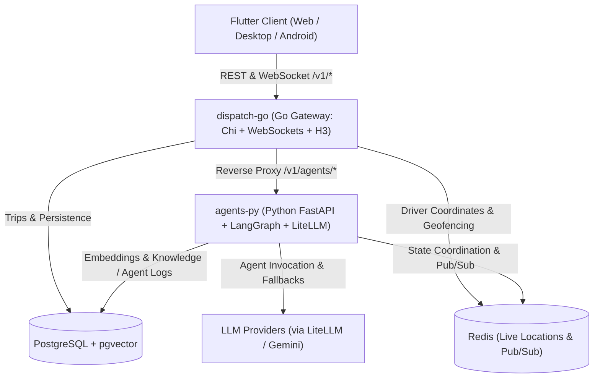

# PROJECT_CONTEXT: HexaGo

## 1. Product Vision
**HexaGo** is an AI-native Mobility-as-a-Service (MaaS) ride-hailing platform (an Uber replica) engineered for **zero-human operations**.
- **AI-Native Operations**: Every operational task—from booking negotiation, matching, dynamic surge pricing, pooling optimization, and real-time safety monitoring to fraud settlement and jurisdiction compliance—is orchestrated by autonomous, collaborative AI agents.
- **100% AI-Generated Codebase**: All software architecture, services, application layers, infrastructure blueprints, and automated tests are authored and maintained by AI agents. No hand-written application code.

---

## 2. System Architecture

### Components
1. **Frontend (`apps/hexago_app`)**:
   - Built with Flutter supporting Web, Desktop (Windows, macOS, Linux), and Android.
   - Unified interface offering three operational personas:
     - **Rider**: Real-time quote negotiation, trip tracking, pool acceptance, safety status.
     - **Driver**: Telemetry ingestion, dispatch offers, dynamic route recommendations, settlement ledger.
     - **Ops Command Center**: Real-time agent event stream, swarm health metrics, override controls, override simulation.

2. **API Gateway & Core Dispatch (`services/dispatch-go`)**:
   - Written in Go 1.22+ using Chi router, Gorilla WebSocket, Uber H3 spatial indexing (`uber/h3-go/v4`), `pgx`, and `go-redis`.
   - Acts as the single public API gateway exposing REST endpoints and persistent bi-directional WebSockets.
   - Exposes `/healthz`, `/metrics` (Prometheus), and `/v1/ping`.
   - Reverse-proxies `/v1/agents/*` directly to `agents-py`.
   - Manages high-throughput driver location pings, H3 hexagon quantization, and spatial indexing in Redis.

3. **Autonomous Agent Swarm (`services/agents-py`)**:
   - Built with Python 3.12, FastAPI, LangGraph, LiteLLM, SQLAlchemy, pgvector, and pytest-cov.
   - Houses the multi-agent graph workflows governing dispatch, safety, pricing, and settlements.
   - Connects to PostgreSQL with `pgvector` for agent episodic memory and semantic lookup.
   - Agent platform core (`src/agents_py/core`): `llm.py` (LiteLLM wrapper with cost guardrails), `events.py` (`agent_events` audit rows + Ops feed frames), `memory.py` (pgvector recall with keyword fallback), `graph.py` (LangGraph helpers, `run_with_fallback`, `@agent` registration), `registry.py` (the 11-agent roster). `clients/dispatch.py` talks to dispatch-go.
   - Endpoints (reached through the gateway): `GET /v1/agents` (roster with status, `decisions_last_hour`, `last_decision`, `fallback_rate`), `GET /v1/agents/events?limit=&agent=`, `GET /v1/agents/llm/budget`.
   - Safety Sentinel (`agents/safety`): dispatch-go's `internal/safety` detector POSTs `safety_signal`s to `/v1/safety/signal`; the sentinel decides monitor | check_in | escalate with pure rules (LLM reasoning async, upgrade-only), calls the rider (`safety_call` on `ride:<id>` + `ops`, reply via `POST /v1/safety/checkins/{id}/reply`, 15 s in DEMO_MODE / 30 s), and escalates through dispatch-go (simulated emergency dispatch, `/track/{token}`, driver suspension, contact SMS). `GET /v1/safety/incidents[/{id}]`; closing needs `POST /v1/safety/incidents/{id}/resolve` confirmed by the Ops Supervisor. Tables `incidents`, `incident_timeline`, `safety_checkins` (migration `0100_safety_incidents.sql`).
   - Ops feed: agent events are published to Redis channel `ops` (plain frame) and to `hexago:stream` as `ops
<frame>`, which dispatch-go relays to `/v1/stream` subscribers of the `ops` topic. The Ops Supervisor writes a deterministic heartbeat event every `HEARTBEAT_INTERVAL_S` (300 s).
   - With no `DATABASE_URL` / `REDIS_URL` (or if they fail), events live in a 500-entry in-memory ring and guardrail counters in process memory; the service never crashes on missing infra.

4. **Data & State Layer**:
   - **PostgreSQL + pgvector**: Relational storage for users, vehicles, trips, payments, and the append-only `agent_events` audit table.
   - **Redis**: In-memory ephemeral store for driver geospatial indexes (`GEOADD` / H3 sets), live session state, and inter-service Pub/Sub.

### Live Deployment (Render, Free plan, created manually)
| Service | URL |
|---|---|
| dispatch-go (public gateway) | https://dispatch-go.onrender.com |
| agents-py | https://hexago-65oz.onrender.com |
| hexago-web (Flutter Web) | https://hexago-web.onrender.com |

Redis (Render Key Value `hexago-redis`, Singapore) lives in a **different Render account** than the three services, so internal `redis://red-…` URLs cannot resolve. Both dispatch-go and agents-py use its **External URL** (`rediss://…@singapore-keyvalue.render.com:6379`, TLS) and the instance's Valkey inbound IP rules must allow them. `/healthz?redis=fresh` on either service runs a live connect / PING / pub-sub check and reports the masked URL, failing stage and a hint.

The web app calls only the gateway; `/v1/agents/*` is proxied to agents-py. Both services allow CORS from `CORS_ALLOWED_ORIGINS` (default: the web app origin plus `http://localhost:*` and `http://127.0.0.1:*` for local dev).

---

## 3. Autonomous Agent Roster

HexaGo operates with eleven specialized autonomous agents coordinating via LangGraph workflows:

| Agent Name | Primary Responsibility | Deterministic Fallback Mode |
|---|---|---|
| **Booking Intent** | Parses natural language ride requests, extracts origin/destination/preferences, disambiguates vague drop-offs. | Standard regex & structured form parser. |
| **Dispatch Broker** | Matches rider demand to nearest drivers using H3 spatial clustering and driver preference scores. | Classical nearest-neighbor greedy dispatch based on H3 distance. |
| **Pool Batching** | Analyzes overlapping trip trajectories within 90-second batch windows for multi-rider pooling. | First-come route detour threshold calculation (< 15% added ETA). |
| **Surge Equilibrium** | Analyzes real-time supply/demand elasticity and live traffic to balance pricing. | Fixed multiplier curve based on hex-cell supply/demand ratio. |
| **Demand Forecast** | Predicts hex-level ride requests 15–60 minutes ahead to preemptively position drivers. | Historical moving average by day-of-week and hour bucket. |
| **Safety Sentinel** | Continuously evaluates route anomalies, sudden stops, route deviations, and audio telemetry distress. | Geofence deviation alert (> 500m off planned path for > 3 min). |
| **Compliance Vision** | Audits vehicle inspection photos, driver documents, and regulatory roadworthiness. | Manual hold queue + heuristic OCR verification. |
| **Legal & Jurisdiction** | Adapts tariff regulations, municipal compliance rules, driver working-hour limits per jurisdiction. | Static jurisdiction lookup table by municipal boundaries. |
| **Settlement** | Computes driver earnings, platform take-rates, refunds, dynamic cancellation compensations. | Deterministic distance + duration rate formula. |
| **Support & Dispute** | Handles passenger complaints, lost-and-found items, and route dispute arbitration. | Standard canned escalation workflow & credit issue matrix. |
| **Ops Supervisor** | Monitors multi-agent health, detects reasoning drift, throttles rogue actions, and enforces platform guardrails. | Automatic agent circuit breaker to non-LLM rule engines. |

---

## 4. Coding Conventions & Standards

1. **Test-Driven AI Development**:
   - Tests **must** be written and verified before feature implementation.
   - CI executes test suites with coverage thresholds for every PR:
     - Go: `go test -race -cover ./...`
     - Python: `pytest --cov=. --cov-report=term-missing`
     - Flutter: `flutter analyze` and `flutter test --coverage`
2. **Observability & Diagnostics**:
   - Every service must expose:
     - `/healthz`: Liveness and readiness probe responding with HTTP 200 and structured component status.
     - `/metrics`: Prometheus-compatible metrics endpoint.
3. **Configuration & Secrets**:
   - Zero hardcoded secrets or environment targets. All runtime configuration is driven strictly through environment variables.
   - Standardized keys: `LLM_MODEL`, `GEMINI_API_KEY`, `DATABASE_URL`, `REDIS_URL`, `AGENTS_URL`, `DISPATCH_URL`, `DEMO_MODE`, `CITY_CENTER_LAT`, `CITY_CENTER_LNG`, `CORS_ALLOWED_ORIGINS`.
   - LLM guardrail keys (agents-py): `LLM_ENABLED` (default `true`), `LLM_TIMEOUT_S` (`4`), `LLM_BACKOFF_S` (`0.5`), `LLM_DAILY_CALL_LIMIT` (`300`), `LLM_DAILY_TOKEN_LIMIT` (`200000`), `LLM_MIN_INTERVAL_S` (`20`), `LLM_CACHE_TTL_S` (`600`), `EMBEDDING_MODEL` (`gemini/gemini-embedding-001`, requested at 768 dims), `HEARTBEAT_INTERVAL_S` (`300`, `0` disables).
4. **Pluggable LLM Backends**:
   - All agent inference routes through LiteLLM configured by `LLM_MODEL` (default `gemini/gemini-3.5-flash-lite`; e.g. `openai/gpt-4o-mini`, `anthropic/claude-3-5-haiku`), then `LLM_FALLBACK_MODELS` (comma-separated, default `gemini/gemini-3.1-flash-lite,gemini/gemini-3-flash-preview`). A model that answers 404 is dropped for the life of the process; a 429/503 backs off (`LLM_BACKOFF_S`, doubling, max 8 s) and moves to the next model. gemini-2.x and `text-embedding-004` answer 404 as of 2026-11-18.
5. **Deterministic Non-LLM Fallbacks**:
   - Every single agent must implement a reliable, deterministic non-LLM fallback algorithm. If the LLM provider times out, throttles, or returns malformed structured output, the platform continues uninterrupted without human intervention.
6. **Immutable Audit Trail (`agent_events`)**:
   - Every agent invocation, input context, model decision, confidence score, token cost, and fallback activation is logged to the `agent_events` database table. The Ops Command Center visualizes this live stream.
7. **LLM Cost Guardrails (mandatory)**:
   - Agents never call a provider directly: every completion goes through `core.llm.complete_json(prompt, schema, agent_name, fallback)` and every embedding through `LLMClient.embed`.
   - Checks, in order: `LLM_ENABLED` (and a `GEMINI_API_KEY` for `gemini/*` models) → response cache (sha256 of model + prompt in Redis, 10 min TTL) → per-agent minimum interval `LLM_MIN_INTERVAL_S` → daily call and token budgets, kept in Redis and reset at midnight IST (in-memory fallback if Redis is down).
   - Provider calls time out after `LLM_TIMEOUT_S`; each failed attempt moves to the next model in the chain (a single-model chain is retried once). All guardrail time reads (day keys, min interval, cache TTL) go through the injected clock; Redis only ever gets relative TTLs. Whenever a guardrail blocks, the timeout hits, the provider errors, or the output fails schema validation, the caller's deterministic fallback runs and the result is marked `used_fallback=true` with `fallback_reason` one of `disabled | budget | rate | timeout | error`.
   - LLM calls are event-driven only: agents call the LLM on meaningful events (booking request, incident, unusual surge), never on every tick.
   - `GET /v1/agents/llm/budget` reports `calls_today`, `tokens_today`, `limits`, `enabled`, `cache_hits`.
8. **Default Demo City**:
   - **Bengaluru, India**
   - Configurable via `CITY_CENTER_LAT` (default: `12.9716`) and `CITY_CENTER_LNG` (default: `77.5946`).

