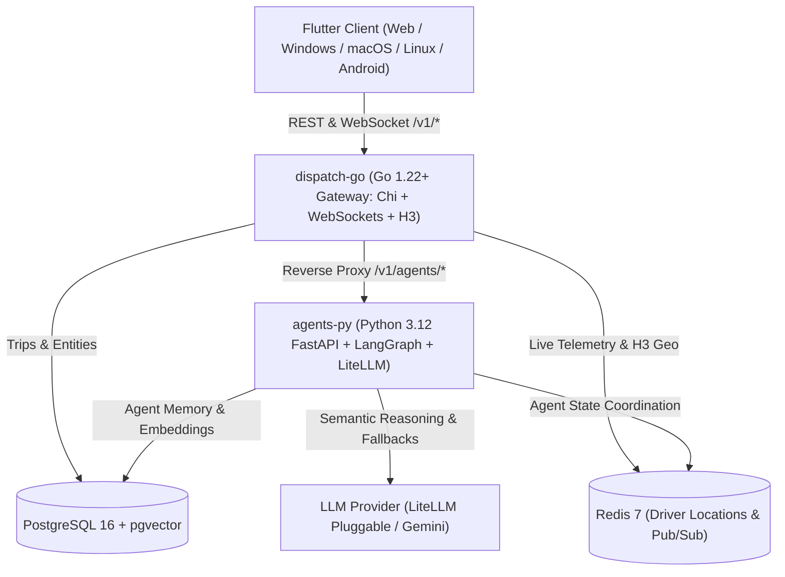

# HexaGo

**HexaGo** is an AI-native Mobility-as-a-Service (MaaS) ride-hailing platform engineered for **zero-human operations**. All platform capabilities—from natural language booking parsing, H3 spatial dispatch matching, dynamic pooling, and surge equilibrium to safety anomaly detection and automated settlement—are orchestrated by autonomous AI multi-agent swarms.

100% of the architecture, services, application code, blueprints, and tests are AI-authored.

## Live Deployment

All services run on Render (Free plan, created manually; see [Manual Render setup](#manual-render-setup)):

| Service | URL |
|---|---|
| Web app (Flutter Web) | https://hexago-web.onrender.com |
| Gateway (`dispatch-go`) | https://dispatch-go.onrender.com |
| Agents (`agents-py`) | https://hexago-65oz.onrender.com |

Quick checks: [`/healthz`](https://dispatch-go.onrender.com/healthz) and [`/v1/agents/ping`](https://dispatch-go.onrender.com/v1/agents/ping) (proxied to agents-py). Free services sleep when idle, so the first request can take about a minute.

---

## Architecture Overview



---

## Monorepo Layout

```
HexaGo/
├── apps/
│   └── hexago_app/          # Flutter client (Web, Desktop: Win/macOS/Linux, Android)
├── services/
│   ├── dispatch-go/         # Go gateway (Chi, Gorilla WebSocket, Uber H3, pgx, go-redis)
│   └── agents-py/           # Python multi-agent swarm (FastAPI, LangGraph, LiteLLM, pgvector)
├── infra/                   # Infrastructure guides & manifests
├── docs/                    # Autonomous coding log and system documentation
├── loadtest/                # Load simulation and telemetry stress scripts
├── .github/workflows/       # GitHub Actions CI workflow (Go, Python, Flutter)
├── render.yaml              # Render Blueprint deploying Gateway, Agents, Web, DB & Redis
├── docker-compose.yml       # Local multi-service orchestration
├── dev.ps1                  # Unified developer PowerShell automation harness
├── PROJECT_CONTEXT.md       # Product vision, agent roster, and architecture standards
└── .env.example             # Standard environment variable template
```

---

## Autonomous Agent Roster

1. **Booking Intent Agent**: NL parsing with deterministic non-LLM regex/rule fallback.
2. **Dispatch Broker Agent**: Spatial H3 clustering and driver-rider matching.
3. **Pool Batching Agent**: 90-second batch window trajectory optimization.
4. **Surge Equilibrium Agent**: Real-time hex supply/demand elasticity pricing.
5. **Demand Forecast Agent**: 15–60 min predictive supply positioning.
6. **Safety Sentinel Agent**: Route anomaly, telemetry distress, and deviation alerts.
7. **Compliance Vision Agent**: Multimodal vehicle inspection and driver license verification.
8. **Legal & Jurisdiction Agent**: Municipal regulations and tariff enforcement.
9. **Settlement Agent**: Algorithmic driver earnings and dispute compensations.
10. **Support & Dispute Agent**: Conversational arbitration and refund processing.
11. **Ops Supervisor Agent**: Swarm monitoring, drift detection, and guardrail enforcement.

---

## Local Development & Setup

### Prerequisites
- **OS**: Windows (PowerShell) / Linux / macOS
- **Go**: 1.22+ (tested with Go 1.27)
- **Python**: Python 3.12 (`py -3.12`)
- **Flutter**: 3.50+ / Dart 3.14+
- **Docker**: Docker Desktop with Compose v2

### 1. Environment Configuration
Copy the template environment file:
```powershell
Copy-Item .env.example .env
```

### 2. Quick Start with Docker Compose
To start PostgreSQL (pgvector), Redis, `dispatch-go`, and `agents-py` all together:
```powershell
docker compose up --build
```

### 3. Developer Automation Harness (`dev.ps1`)
Use the included `dev.ps1` script to manage local development and execute test suites:

```powershell
# 1. Start Postgres (pgvector) and Redis in background
.\dev.ps1 up

# 2. Run Go Gateway unit & integration tests with coverage
.\dev.ps1 test-go

# 3. Run Python multi-agent tests with coverage (uses services/agents-py/.venv automatically)
.\dev.ps1 test-py

# 4. Run Flutter static analysis and widget test suite
.\dev.ps1 test-flutter

# 5. Run ALL test suites across the monorepo in sequence
.\dev.ps1 test-all

# 6. Launch Flutter Web in Chrome wired to local dispatch-go gateway
.\dev.ps1 web
```

---

## CORS

Both services read `CORS_ALLOWED_ORIGINS`, a comma-separated list of allowed browser origins. An entry ending in `:*` matches that host on any port (for Flutter dev servers). The default is `https://hexago-web.onrender.com,http://localhost:*,http://127.0.0.1:*`. The gateway also uses the list to check WebSocket `Origin` headers (native clients without an `Origin` are allowed), and it drops CORS headers from proxied agents-py responses so the browser sees one set.

---

## API Gateway Endpoints (`dispatch-go`)

| Endpoint | Method | Description |
|---|---|---|
| `/healthz` | `GET` | Gateway health check probe (JSON) |
| `/metrics` | `GET` | Prometheus-compatible metrics stream |
| `/v1/ping` | `GET` | Gateway ping route |
| `/v1/ws` | `GET` | Bidirectional WebSocket for telemetry & dispatch |
| `/v1/agents/*` | `ANY` | Reverse proxy forwarding to `agents-py` |

---

## Multi-Agent Brain Endpoints (`agents-py`)

| Endpoint | Method | Description |
|---|---|---|
| `/healthz` | `GET` | Python service health & active model probe |
| `/metrics` | `GET` | Prometheus-compatible metrics stream |
| `/v1/agents/ping` | `GET` | Agent service ping route |
| `/v1/agents/parse-intent` | `POST` | Booking Intent Agent with deterministic fallback |

---

## CI/CD Pipeline

The `.github/workflows/ci.yml` pipeline runs on every push and pull request:
- **Go**: `go test -v -race -coverprofile=coverage.out ./...` with CGO enabled.
- **Python**: `pytest -v --cov=. --cov-report=term-missing` on Python 3.12.
- **Flutter**: `flutter analyze` and `flutter test --coverage`.

---

## Cloud Deployment (Render Blueprint)

HexaGo includes a top-level `render.yaml` Blueprint specification deploying:
- `hexago-postgres`: Managed PostgreSQL 16 with pgvector
- `hexago-redis`: Managed Key-Value store
- `dispatch-go`: Docker web service gateway on port 8080
- `agents-py`: Docker web service autonomous brain on port 8000
- `hexago-web`: Static site running Flutter Web release build

## Manual Render setup

Use this checklist to create every resource by hand in the Render dashboard, all on the **Free** plan, without the Blueprint.
Create them **in this order**: later steps paste URLs from earlier ones.

**Before you start**
- Pick **one region for everything** (e.g. **Singapore**, the closest to Bengaluru). Internal URLs only work inside one region.
- Leave `PORT` **unset** on both web services. Render injects it (default `10000`), and both services listen on it: dispatch-go reads `PORT`, and agents-py's Dockerfile starts uvicorn with `--port ${PORT:-8000}`.
- Both Dockerfiles use **their own service folder** as the Docker build context (they `COPY go.mod` / `COPY requirements.txt` from it). They do **not** expect the repo root.

### 1. hexago-postgres (New → Postgres)
| Field | Value |
|---|---|
| Name | `hexago-postgres` |
| Database | `hexago` |
| User | `hexago` |
| Region | your chosen region |
| PostgreSQL Version | `16` |
| Plan | Free |

When it's live, copy the **Internal Database URL** from the database's *Info* page. You'll need it in steps 3 and 4.

### 2. hexago-redis (New → Key Value)
| Field | Value |
|---|---|
| Name | `hexago-redis` |
| Region | same region |
| Maxmemory Policy | `allkeys-lru` (default is fine) |
| Plan | Free |

When it's live, copy the **Internal Key Value URL** (`redis://red-…:6379`). You'll need it in steps 3 and 4.

### 3. agents-py (New → Web Service → your repo)
| Field | Value |
|---|---|
| Name | `agents-py` |
| Language / Runtime | `Docker` |
| Branch | `main` |
| Region | same region |
| Root Directory | `services/agents-py` |
| Dockerfile Path | `./Dockerfile` (relative to Root Directory) |
| Docker Build Context Directory | `.` (relative to Root Directory) |
| Health Check Path (Advanced) | `/healthz` |
| Plan | Free |

Environment variables:
| Key | Value | Source |
|---|---|---|
| `LLM_MODEL` | `gemini/gemini-2.5-flash` | literal |
| `GEMINI_API_KEY` | your Gemini API key | your secret |
| `DATABASE_URL` | Internal Database URL | copy from **hexago-postgres** |
| `REDIS_URL` | Internal Key Value URL | copy from **hexago-redis** |
| `DEMO_MODE` | `true` | literal |
| `CITY_CENTER_LAT` | `12.9716` | literal |
| `CITY_CENTER_LNG` | `77.5946` | literal |
| `CORS_ALLOWED_ORIGINS` | optional; defaults to `https://hexago-web.onrender.com,http://localhost:*,http://127.0.0.1:*` | literal |

When it's live, copy its **public URL** from the top of the service page, e.g. `https://agents-py.onrender.com`. Render may add a suffix such as `agents-py-ab12.onrender.com`, so copy the real one. To confirm it works, open `<url>/healthz`.

### 4. dispatch-go (New → Web Service → your repo)
| Field | Value |
|---|---|
| Name | `dispatch-go` |
| Language / Runtime | `Docker` |
| Branch | `main` |
| Region | same region |
| Root Directory | `services/dispatch-go` |
| Dockerfile Path | `./Dockerfile` (relative to Root Directory) |
| Docker Build Context Directory | `.` (relative to Root Directory) |
| Health Check Path (Advanced) | `/healthz` |
| Plan | Free |

Environment variables:
| Key | Value | Source |
|---|---|---|
| `AGENTS_URL` | agents-py public URL, e.g. `https://hexago-65oz.onrender.com` (no trailing slash) | copy from **agents-py** |
| `DATABASE_URL` | Internal Database URL | copy from **hexago-postgres** |
| `REDIS_URL` | Internal Key Value URL | copy from **hexago-redis** |
| `DEMO_MODE` | `true` | literal |
| `CITY_CENTER_LAT` | `12.9716` | literal |
| `CITY_CENTER_LNG` | `77.5946` | literal |
| `CORS_ALLOWED_ORIGINS` | optional; defaults to `https://hexago-web.onrender.com,http://localhost:*,http://127.0.0.1:*` | literal |

When it's live, copy its public URL (e.g. `https://dispatch-go.onrender.com`). To confirm it works, open `<url>/healthz`. To check that requests reach agents-py, open `<url>/v1/agents/ping`.

### 5. hexago-web (New → Static Site → your repo)
| Field | Value |
|---|---|
| Name | `hexago-web` |
| Branch | `main` |
| Root Directory | `apps/hexago_app` |
| Build Command | see below |
| Publish Directory | `build/web` (relative to Root Directory) |

Build Command (paste as one line):
```bash
if [ ! -d "$HOME/flutter" ]; then git clone https://github.com/flutter/flutter.git -b stable --depth 1 "$HOME/flutter"; fi && export PATH="$PATH:$HOME/flutter/bin" && flutter config --enable-web && flutter build web --release --dart-define=API_BASE_URL="$API_BASE_URL" --dart-define=WS_BASE_URL="$WS_BASE_URL"
```

Environment variables (Flutter bakes these in at build time, so redeploy after changing them):
| Key | Value | Source |
|---|---|---|
| `API_BASE_URL` | dispatch-go public URL, e.g. `https://dispatch-go.onrender.com` | copy from **dispatch-go** |
| `WS_BASE_URL` | same host with `wss://`, e.g. `wss://dispatch-go.onrender.com` | copy from **dispatch-go** |

After it's created, open **Redirects/Rewrites** and add a rule: Source `/*`, Destination `/index.html`, Action **Rewrite**.

### Free-plan caveats
- Free web services sleep after about 15 minutes idle, and the first request after that takes about a minute. dispatch-go's 15 s write timeout can cut off a proxied call to a sleeping agents-py, so wake agents-py first by opening its `/healthz`.
- Free Postgres databases expire about 30 days after creation, unless upgraded.
- Free Key Value is in-memory only, with no persistence. That's fine for live driver locations and Pub/Sub.
