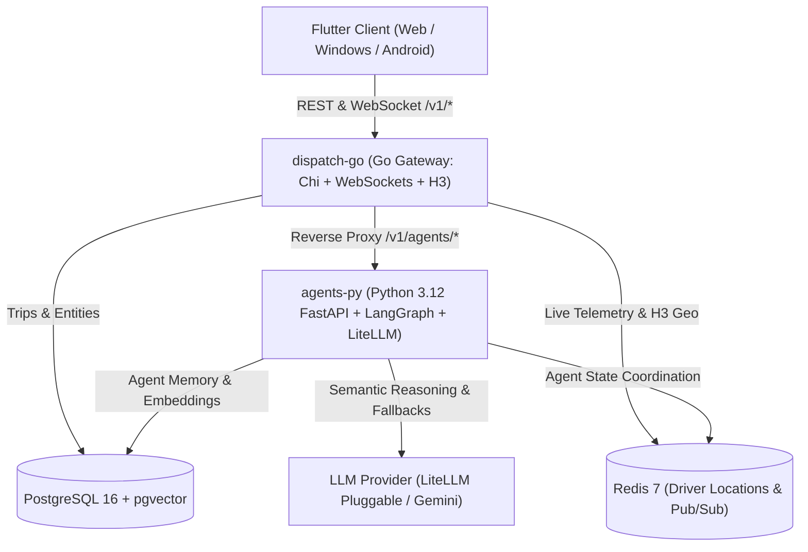

# HexaGo

**HexaGo is an AI-native ride-hailing platform that runs a city with zero humans in the loop.** In live Bengaluru, a simulated fleet of 300 vehicles is matched to riders in microseconds by an H3 dispatch broker. Six autonomous agents book multi-leg trips from a single sentence, price each hexagon by supply and demand, call riders when a trip looks wrong, escalate emergencies, freeze drivers, and settle every fare on a double-entry ledger that balances to ₹0.00. All of it is logged to an append-only audit trail, and each agent has a deterministic fallback for when the LLM is slow or over budget. Every line of code, every test and every doc was written by AI agents, under a test-first check, a 96% coverage gate, and a CI self-healing loop.

## Live links

| | |
|---|---|
| **Web app** | https://hexago-web.onrender.com |
| **API reference (Swagger UI)** | https://dispatch-go.onrender.com/docs · OpenAPI 3.1: [`/openapi.json`](https://dispatch-go.onrender.com/openapi.json) · quickstart: [docs/API.md](docs/API.md) |
| **Downloads** | [Windows x64 (zip)](https://github.com/Sayamgada/HexaGo/releases/latest/download/HexaGo-windows-x64.zip) · [Android (APK)](https://github.com/Sayamgada/HexaGo/releases/latest/download/HexaGo-android.apk) · [all releases](https://github.com/Sayamgada/HexaGo/releases/latest) |
| Gateway (`dispatch-go`) | https://dispatch-go.onrender.com ([`/healthz`](https://dispatch-go.onrender.com/healthz)) |
| Agents (`agents-py`) | https://hexago-65oz.onrender.com (reached through the gateway at `/v1/agents/*`) |

The services run on Render's free plan and sleep when idle, so the first request can take about a minute. The Windows build is unzipped and run as `HexaGo.exe`. The Android APK is debug-signed, so you have to allow installs from unknown sources. Both builds talk to the production gateway and are built by [`release.yml`](.github/workflows/release.yml) on every `v*` tag.

Docs: [Architecture and RFP map](docs/ARCHITECTURE.md) · [10-minute demo script](docs/DEMO_SCRIPT.md) · [Dispatch broker](docs/DISPATCH_BROKER.md) · [Fleet simulator](docs/FLEET_SIMULATOR.md) · [Autocoding pipeline](docs/AUTOCODING.md) · [Autocoding log](docs/AUTOCODING_LOG.md) · [Stats](docs/AUTOCODING_STATS.md)

## Rubric to feature map

| Rubric area | Feature | Where to see it | Code |
|---|---|---|---|
| Zero-human operations | Ops Command Center: live city, "0 humans in the loop · N autonomous decisions today", agent feed, Agents tab (ACTIVE or PLANNED) | Web app → **Ops Command Center** | `apps/hexago_app/lib/features/ops`, `services/agents-py/src/agents_py/core` |
| Geospatial dispatch latency | Adaptive H3 k-ring matching, 64×64 sharded index, scored ranking, free upgrades; live p50 about 120 µs, p99 under 1 ms | Ops metric strip, `GET /v1/metrics/dispatch` | `services/dispatch-go/internal/{geo,fleet,matching,dispatch}` |
| 100% AI-generated code | Test-first check, 96% coverage gate, LLM self-heal ([Sayamgada/HexaGo#1](https://github.com/Sayamgada/HexaGo/pull/1) → [Sayamgada/HexaGo#16](https://github.com/Sayamgada/HexaGo/pull/16) auto-merged), autocoding log and stats | [docs/AUTOCODING.md](docs/AUTOCODING.md), Actions | `tools/`, `.github/workflows/` |
| Autonomous safety | Detector → Safety Sentinel → voice check-in → escalation → driver frozen → timeline and path replay → payout held | Ops → **Safety incident** scenario → **Safety** tab | `services/dispatch-go/internal/safety`, `services/agents-py/src/agents_py/agents/safety` |
| AI booking and pricing | One sentence becomes a multi-leg plan; clarifying questions; rule-based fallback; per-hexagon surge (watch it under **Rain storm**) | Web app → **Rider** | `services/agents-py/src/agents_py/agents/{booking,pricing}` |
| Finance | Double-entry ledger in paise, fare breakdown, instant payouts, holds, refunds, trial balance "Balanced ₹0.00", Settlement auditor | Ops **Money** tile, **Fare breakdown** | `services/dispatch-go/internal/ledger`, `services/agents-py/src/agents_py/agents/settlement` |
| Platform and API | OpenAPI 3.1, scoped API keys, rate limits, signed webhooks, Python and TypeScript SDKs; web, Windows, Android | `/docs`, **Developers** card, Releases | `services/dispatch-go/internal/{developer,apidocs}`, `sdk/` |

See [docs/ARCHITECTURE.md](docs/ARCHITECTURE.md#6-rfp-to-implementation) for what is built, what is simulated (the vehicles, emergency APIs, money movement), and the production upgrade path.

## Screenshots

<!-- Replace each placeholder with an image, e.g.  -->

| | |
|---|---|
| _Ops Command Center: live city and "0 humans" banner (`docs/screenshots/ops.png`)_ | _Agents tab (`docs/screenshots/agents.png`)_ |
| _Safety: escalated incident, timeline and path replay (`docs/screenshots/safety.png`)_ | _Rider: golden-sentence two-leg plan (`docs/screenshots/rider.png`)_ |
| _Surge zones after Rain storm (`docs/screenshots/surge.png`)_ | _Fare breakdown and "Balanced ₹0.00" (`docs/screenshots/finance.png`)_ |
| _Developers screen and Swagger UI (`docs/screenshots/api.png`)_ | _Windows desktop and Android apps (`docs/screenshots/apps.png`)_ |

## Smoke test (live end-to-end)

```powershell
services\agents-py\.venv\Scripts\python.exe tools\smoke.py
```

The script runs 17 checks against the live URLs, prints a pass/fail table with timings, and exits with 1 if any check fails. The checks: health of all three services (waiting up to 2 minutes for cold starts), dispatch p99, a ride created and matched, a driver update on `/v1/stream` within 5 s, the golden-sentence booking with and without `force_fallback`, a pricing quote, the surge map, a 1.5x surge-cap regulation ingested by the Legal agent with the surge map capped at 1.5x after the next recompute (the previous cap is restored unless `--keep-legal`), an Autonomous Ops Report generated, a safety incident (answered "I'm fine"), a ledger trial balance of 0, an API key and a scoped call, `/docs` and `/openapi.json`, and the release assets.

Flags:
- `--gateway`, `--agents`, `--web` (or `HEXAGO_GATEWAY_URL`, `HEXAGO_AGENTS_URL`, `HEXAGO_WEB_URL`) point it at another deployment.
- `--safety escalate` lets the incident escalate instead of answering it.
- `--only safety,ledger` runs a subset.
- `--json out.json` also writes the results to a file.

---

## Architecture Overview



More diagrams (dispatch, safety, ledger, autocoding): [docs/ARCHITECTURE.md](docs/ARCHITECTURE.md).

---

## Monorepo Layout

```
HexaGo/
├── apps/
│   └── hexago_app/          # Flutter client (Web, Desktop: Win/macOS/Linux, Android)
├── services/
│   ├── dispatch-go/         # Go gateway (Chi, Gorilla WebSocket, Uber H3, pgx, go-redis)
│   └── agents-py/           # Python multi-agent swarm (FastAPI, LangGraph, LiteLLM, pgvector)
├── sdk/                     # Python and TypeScript SDKs for the public API
├── tools/                   # Assembly line: coverage gate, self-heal, stats, smoke test
├── infra/                   # Infrastructure guides & manifests
├── docs/                    # Architecture, demo script, API, autocoding log
├── loadtest/                # Load simulation and telemetry stress scripts
├── .github/workflows/       # CI, self-heal, release, keep-warm
├── render.yaml              # Render Blueprint deploying Gateway, Agents, Web, DB & Redis
├── docker-compose.yml       # Local multi-service orchestration
├── dev.ps1                  # Unified developer PowerShell automation harness
├── PROJECT_CONTEXT.md       # Product vision, agent roster, and architecture standards
└── .env.example             # Standard environment variable template
```

---

## Autonomous Agent Roster

Live status: `GET https://dispatch-go.onrender.com/v1/agents`.

| # | Agent | Status | Role |
|---|---|---|---|
| 1 | Booking Intent | Active | Turns natural language into a multi-leg plan; rule-based fallback |
| 2 | Dispatch Broker | Active | H3 matching with scored ranking (deterministic Go) |
| 3 | Pool Batching | Planned | 90-second batch-window pooling |
| 4 | Surge Equilibrium | Active | Per-hexagon supply/demand pricing and surge map |
| 5 | Demand Forecast | Planned | Demand 15 to 60 minutes ahead |
| 6 | Safety Sentinel | Active | Check-ins, escalation, driver suspension |
| 7 | Compliance Vision | Planned | Vehicle and document audits |
| 8 | Legal & Jurisdiction | Planned | Per-city tariffs and rules |
| 9 | Settlement | Active | Audits ledger entries and payouts |
| 10 | Support & Dispute | Planned | Complaints, lost and found, refunds |
| 11 | Ops Supervisor | Active | Heartbeat, guardrails, confirms incident resolution |

---

## Local Development & Setup

### Prerequisites
- **OS**: Windows (PowerShell) / Linux / macOS
- **Go**: 1.22+ (tested with Go 1.27)
- **Python**: Python 3.12 (`py -3.12`)
- **Flutter**: 3.50+ / Dart 3.14+
- **Docker**: Docker Desktop with Compose v2

### 1. Environment Configuration
Copy the template environment file:
```powershell
Copy-Item .env.example .env
```

### 2. Quick Start with Docker Compose
To start PostgreSQL (pgvector), Redis, `dispatch-go`, and `agents-py` all together:
```powershell
docker compose up --build
```

### 3. Developer Automation Harness (`dev.ps1`)
Use the included `dev.ps1` script to manage local development and execute test suites:

```powershell
# 1. Start Postgres (pgvector) and Redis in background
.\dev.ps1 up

# 2. Run Go Gateway unit & integration tests with coverage
.\dev.ps1 test-go

# 3. Run Python multi-agent tests with coverage (uses services/agents-py/.venv automatically)
.\dev.ps1 test-py

# 4. Run Flutter static analysis and widget test suite
.\dev.ps1 test-flutter

# 5. Run ALL test suites across the monorepo in sequence
.\dev.ps1 test-all

# 6. Launch Flutter Web in Chrome wired to local dispatch-go gateway
.\dev.ps1 web
```

### 4. Smoke-test a local stack
With `dispatch-go` on :8080 and `agents-py` on :8000 (pass `--web` the URL `flutter run` prints; the release check still reads GitHub):
```powershell
services\agents-py\.venv\Scripts\python.exe tools\smoke.py --gateway http://localhost:8080 --agents http://localhost:8000 --web http://localhost:<flutter-port>
```

---

## CORS

Both services read `CORS_ALLOWED_ORIGINS`, a comma-separated list of allowed browser origins. An entry ending in `:*` matches that host on any port (for Flutter dev servers). The default is `https://hexago-web.onrender.com,http://localhost:*,http://127.0.0.1:*`. The gateway also uses the list to check WebSocket `Origin` headers (native clients without an `Origin` are allowed), and it drops CORS headers from proxied agents-py responses so the browser sees one set.

---

## API Gateway Endpoints (`dispatch-go`)

| Endpoint | Method | Description |
|---|---|---|
| `/healthz` | `GET` | Gateway health check probe (JSON) |
| `/metrics` | `GET` | Prometheus-compatible metrics stream |
| `/v1/ping` | `GET` | Gateway ping route |
| `/v1/ws` | `GET` | Bidirectional WebSocket for telemetry & dispatch |
| `/v1/agents/*` | `ANY` | Reverse proxy forwarding to `agents-py` |
| `/openapi.json`, `/docs` | `GET` | OpenAPI 3.1 document of every public endpoint, Swagger UI |
| `/v1/developer/*` | `POST/GET/DELETE` | API keys (scopes, per-key rate limits) and signed webhooks: see [`docs/API.md`](docs/API.md) |

---

## Multi-Agent Brain Endpoints (`agents-py`)

| Endpoint | Method | Description |
|---|---|---|
| `/healthz` | `GET` | Python service health & active model probe |
| `/metrics` | `GET` | Prometheus-compatible metrics stream |
| `/v1/agents/ping` | `GET` | Agent service ping route |
| `/v1/agents/parse-intent` | `POST` | Booking Intent Agent with deterministic fallback |

---

## CI/CD Pipeline

The `.github/workflows/ci.yml` pipeline runs on every push and pull request:
- **Go**: `go test -v -race -coverprofile=coverage.out ./...` with CGO enabled.
- **Python**: `pytest -v --cov=. --cov-report=term-missing` on Python 3.12.
- **Flutter**: `flutter analyze` and `flutter test --coverage`.

`.github/workflows/release.yml` builds the Windows zip and the Android APK on `v*` tags (or manually) and attaches them to the GitHub Release. `.github/workflows/keep-warm.yml` pings the gateway, agents-py and the web app every 10 minutes while the repository variable `KEEP_WARM` is `true` (`gh variable set KEEP_WARM --body false` turns it off).

---

## Cloud Deployment (Render Blueprint)

HexaGo includes a top-level `render.yaml` Blueprint specification deploying:
- `hexago-postgres`: Managed PostgreSQL 16 with pgvector
- `hexago-redis`: Managed Key-Value store
- `dispatch-go`: Docker web service gateway on port 8080
- `agents-py`: Docker web service autonomous brain on port 8000
- `hexago-web`: Static site running Flutter Web release build

## Manual Render setup

Use this checklist to create every resource by hand in the Render dashboard, all on the **Free** plan, without the Blueprint.
Create them **in this order**: later steps paste URLs from earlier ones.

**Before you start**
- Pick **one region for everything** (e.g. **Singapore**, the closest to Bengaluru). Internal URLs only work inside one region.
- Leave `PORT` **unset** on both web services. Render injects it (default `10000`), and both services listen on it: dispatch-go reads `PORT`, and agents-py's Dockerfile starts uvicorn with `--port ${PORT:-8000}`.
- Both Dockerfiles use **their own service folder** as the Docker build context (they `COPY go.mod` / `COPY requirements.txt` from it). They do **not** expect the repo root.

### 1. hexago-postgres (New → Postgres)
| Field | Value |
|---|---|
| Name | `hexago-postgres` |
| Database | `hexago` |
| User | `hexago` |
| Region | your chosen region |
| PostgreSQL Version | `16` |
| Plan | Free |

When it's live, copy the **Internal Database URL** from the database's *Info* page. You'll need it in steps 3 and 4.

### 2. hexago-redis (New → Key Value)
| Field | Value |
|---|---|
| Name | `hexago-redis` |
| Region | same region |
| Maxmemory Policy | `allkeys-lru` (default is fine) |
| Plan | Free |

When it's live, copy the **Internal Key Value URL** (`redis://red-…:6379`). You'll need it in steps 3 and 4.

### 3. agents-py (New → Web Service → your repo)
| Field | Value |
|---|---|
| Name | `agents-py` |
| Language / Runtime | `Docker` |
| Branch | `main` |
| Region | same region |
| Root Directory | `services/agents-py` |
| Dockerfile Path | `./Dockerfile` (relative to Root Directory) |
| Docker Build Context Directory | `.` (relative to Root Directory) |
| Health Check Path (Advanced) | `/healthz` |
| Plan | Free |

Environment variables:
| Key | Value | Source |
|---|---|---|
| `LLM_MODEL` | `gemini/gemini-3.5-flash-lite` | literal |
| `LLM_FALLBACK_MODELS` | `gemini/gemini-3.1-flash-lite,gemini/gemini-3-flash-preview` | literal |
| `EMBEDDING_MODEL` | `gemini/gemini-embedding-001` | literal |
| `LLM_TIMEOUT_S` | `4` | literal |
| `DISPATCH_URL` | `https://dispatch-go.onrender.com` | literal |
| `HEARTBEAT_INTERVAL_S` | optional; `300` (`0` disables) | literal |
| other `LLM_*` guardrails | optional; defaults in `.env.example` | literal |
| `GEMINI_API_KEY` | your Gemini API key | your secret |
| `DATABASE_URL` | Internal Database URL | copy from **hexago-postgres** |
| `REDIS_URL` | Internal Key Value URL | copy from **hexago-redis** |
| `DEMO_MODE` | `true` | literal |
| `CITY_CENTER_LAT` | `12.9716` | literal |
| `CITY_CENTER_LNG` | `77.5946` | literal |
| `CORS_ALLOWED_ORIGINS` | optional; defaults to `https://hexago-web.onrender.com,http://localhost:*,http://127.0.0.1:*` | literal |

When it's live, copy its **public URL** from the top of the service page, e.g. `https://agents-py.onrender.com`. Render may add a suffix such as `agents-py-ab12.onrender.com`, so copy the real one. To confirm it works, open `<url>/healthz`.

### 4. dispatch-go (New → Web Service → your repo)
| Field | Value |
|---|---|
| Name | `dispatch-go` |
| Language / Runtime | `Docker` |
| Branch | `main` |
| Region | same region |
| Root Directory | `services/dispatch-go` |
| Dockerfile Path | `./Dockerfile` (relative to Root Directory) |
| Docker Build Context Directory | `.` (relative to Root Directory) |
| Health Check Path (Advanced) | `/healthz` |
| Plan | Free |

Environment variables:
| Key | Value | Source |
|---|---|---|
| `AGENTS_URL` | agents-py public URL, e.g. `https://hexago-65oz.onrender.com` (no trailing slash) | copy from **agents-py** |
| `DATABASE_URL` | Internal Database URL | copy from **hexago-postgres** |
| `REDIS_URL` | Internal Key Value URL | copy from **hexago-redis** |
| `DEMO_MODE` | `true` | literal |
| `CITY_CENTER_LAT` | `12.9716` | literal |
| `CITY_CENTER_LNG` | `77.5946` | literal |
| `CORS_ALLOWED_ORIGINS` | optional; defaults to `https://hexago-web.onrender.com,http://localhost:*,http://127.0.0.1:*` | literal |

When it's live, copy its public URL (e.g. `https://dispatch-go.onrender.com`). To confirm it works, open `<url>/healthz`. To check that requests reach agents-py, open `<url>/v1/agents/ping`.

### 5. hexago-web (New → Static Site → your repo)
| Field | Value |
|---|---|
| Name | `hexago-web` |
| Branch | `main` |
| Root Directory | `apps/hexago_app` |
| Build Command | see below |
| Publish Directory | `build/web` (relative to Root Directory) |

Build Command (paste as one line):
```bash
if [ ! -d "$HOME/flutter" ]; then git clone https://github.com/flutter/flutter.git -b stable --depth 1 "$HOME/flutter"; fi && export PATH="$PATH:$HOME/flutter/bin" && flutter config --enable-web && flutter build web --release --dart-define=API_BASE_URL="$API_BASE_URL" --dart-define=WS_BASE_URL="$WS_BASE_URL"
```

Environment variables (Flutter bakes these in at build time, so redeploy after changing them):
| Key | Value | Source |
|---|---|---|
| `API_BASE_URL` | dispatch-go public URL, e.g. `https://dispatch-go.onrender.com` | copy from **dispatch-go** |
| `WS_BASE_URL` | same host with `wss://`, e.g. `wss://dispatch-go.onrender.com` | copy from **dispatch-go** |

After it's created, open **Redirects/Rewrites** and add a rule: Source `/*`, Destination `/index.html`, Action **Rewrite**.

### Free-plan caveats
- Free web services sleep after about 15 minutes idle, and the first request after that takes about a minute. dispatch-go's 15 s write timeout can cut off a proxied call to a sleeping agents-py, so wake agents-py first by opening its `/healthz`.
- Free Postgres databases expire about 30 days after creation, unless upgraded.
- Free Key Value is in-memory only, with no persistence. That's fine for live driver locations and Pub/Sub.
