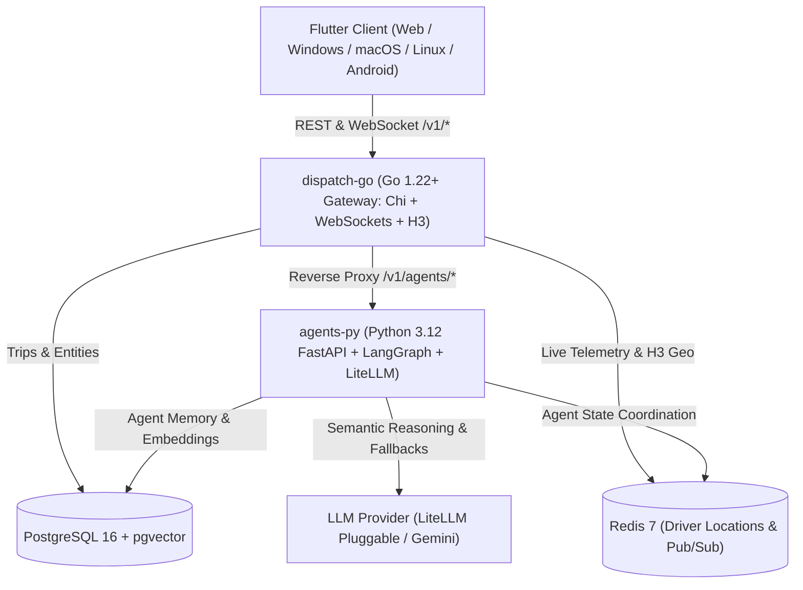

# HexaGo 🚕 🤖

**HexaGo** is an AI-native Mobility-as-a-Service (MaaS) ride-hailing platform engineered for **zero-human operations**. All platform capabilities—from natural language booking parsing, H3 spatial dispatch matching, dynamic pooling, and surge equilibrium to safety anomaly detection and automated settlement—are orchestrated by autonomous AI multi-agent swarms.

100% of the architecture, services, application code, blueprints, and tests are AI-authored.

---

## Architecture Overview



---

## Monorepo Layout

```
HexaGo/
├── apps/
│   └── hexago_app/          # Flutter client (Web, Desktop: Win/macOS/Linux, Android)
├── services/
│   ├── dispatch-go/         # Go gateway (Chi, Gorilla WebSocket, Uber H3, pgx, go-redis)
│   └── agents-py/           # Python multi-agent swarm (FastAPI, LangGraph, LiteLLM, pgvector)
├── infra/                   # Infrastructure guides & manifests
├── docs/                    # Autonomous coding log and system documentation
├── loadtest/                # Load simulation and telemetry stress scripts
├── .github/workflows/       # GitHub Actions CI workflow (Go, Python, Flutter)
├── render.yaml              # Render Blueprint deploying Gateway, Agents, Web, DB & Redis
├── docker-compose.yml       # Local multi-service orchestration
├── dev.ps1                  # Unified developer PowerShell automation harness
├── PROJECT_CONTEXT.md       # Product vision, agent roster, and architecture standards
└── .env.example             # Standard environment variable template
```

---

## Autonomous Agent Roster

1. **Booking Intent Agent**: NL parsing with deterministic non-LLM regex/rule fallback.
2. **Dispatch Broker Agent**: Spatial H3 clustering and driver-rider matching.
3. **Pool Batching Agent**: 90-second batch window trajectory optimization.
4. **Surge Equilibrium Agent**: Real-time hex supply/demand elasticity pricing.
5. **Demand Forecast Agent**: 15–60 min predictive supply positioning.
6. **Safety Sentinel Agent**: Route anomaly, telemetry distress, and deviation alerts.
7. **Compliance Vision Agent**: Multimodal vehicle inspection and driver license verification.
8. **Legal & Jurisdiction Agent**: Municipal regulations and tariff enforcement.
9. **Settlement Agent**: Algorithmic driver earnings and dispute compensations.
10. **Support & Dispute Agent**: Conversational arbitration and refund processing.
11. **Ops Supervisor Agent**: Swarm monitoring, drift detection, and guardrail enforcement.

---

## Local Development & Setup

### Prerequisites
- **OS**: Windows (PowerShell) / Linux / macOS
- **Go**: 1.22+ (tested with Go 1.27)
- **Python**: Python 3.12 (`py -3.12`)
- **Flutter**: 3.50+ / Dart 3.14+
- **Docker**: Docker Desktop with Compose v2

### 1. Environment Configuration
Copy the template environment file:
```powershell
Copy-Item .env.example .env
```

### 2. Quick Start with Docker Compose
To start PostgreSQL (pgvector), Redis, `dispatch-go`, and `agents-py` all together:
```powershell
docker compose up --build
```

### 3. Developer Automation Harness (`dev.ps1`)
Use the included `dev.ps1` script to manage local development and execute test suites:

```powershell
# 1. Start Postgres (pgvector) and Redis in background
.\dev.ps1 up

# 2. Run Go Gateway unit & integration tests with coverage
.\dev.ps1 test-go

# 3. Run Python multi-agent tests with coverage (uses services/agents-py/.venv automatically)
.\dev.ps1 test-py

# 4. Run Flutter static analysis and widget test suite
.\dev.ps1 test-flutter

# 5. Run ALL test suites across the monorepo in sequence
.\dev.ps1 test-all

# 6. Launch Flutter Web in Chrome wired to local dispatch-go gateway
.\dev.ps1 web
```

---

## API Gateway Endpoints (`dispatch-go`)

| Endpoint | Method | Description |
|---|---|---|
| `/healthz` | `GET` | Gateway health check probe (JSON) |
| `/metrics` | `GET` | Prometheus-compatible metrics stream |
| `/v1/ping` | `GET` | Gateway ping route |
| `/v1/ws` | `GET` | Bidirectional WebSocket for telemetry & dispatch |
| `/v1/agents/*` | `ANY` | Reverse proxy forwarding to `agents-py` |

---

## Multi-Agent Brain Endpoints (`agents-py`)

| Endpoint | Method | Description |
|---|---|---|
| `/healthz` | `GET` | Python service health & active model probe |
| `/metrics` | `GET` | Prometheus-compatible metrics stream |
| `/v1/agents/ping` | `GET` | Agent service ping route |
| `/v1/agents/parse-intent` | `POST` | Booking Intent Agent with deterministic fallback |

---

## CI/CD Pipeline

The `.github/workflows/ci.yml` pipeline runs on every push and pull request:
- **Go**: `go test -v -race -coverprofile=coverage.out ./...` with CGO enabled.
- **Python**: `pytest -v --cov=. --cov-report=term-missing` on Python 3.12.
- **Flutter**: `flutter analyze` and `flutter test --coverage`.

---

## Cloud Deployment (Render Blueprint)

HexaGo includes a top-level `render.yaml` Blueprint specification deploying:
- `hexago-postgres`: Managed PostgreSQL 16 with pgvector
- `hexago-redis`: Managed Key-Value store
- `dispatch-go`: Docker web service gateway on port 8080
- `agents-py`: Docker web service autonomous brain on port 8000
- `hexago-web`: Static site running Flutter Web release build
