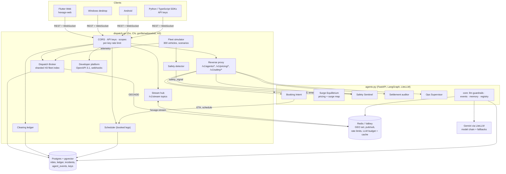
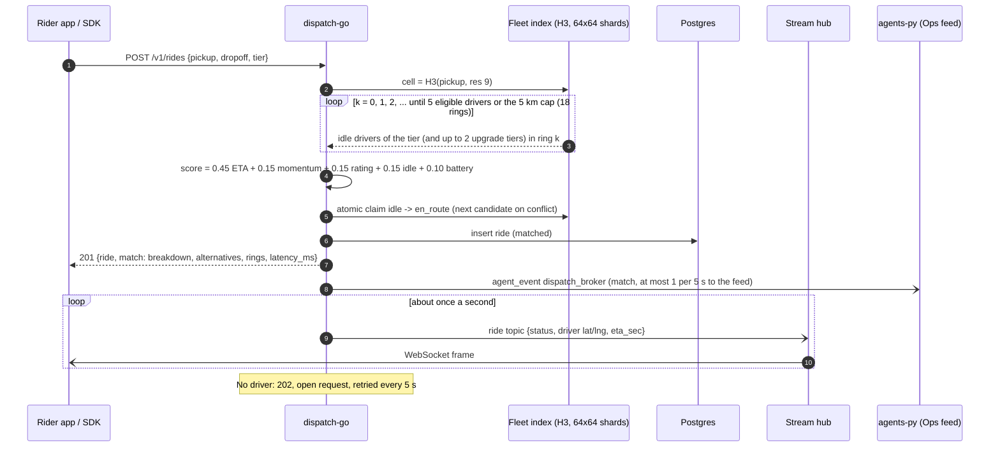
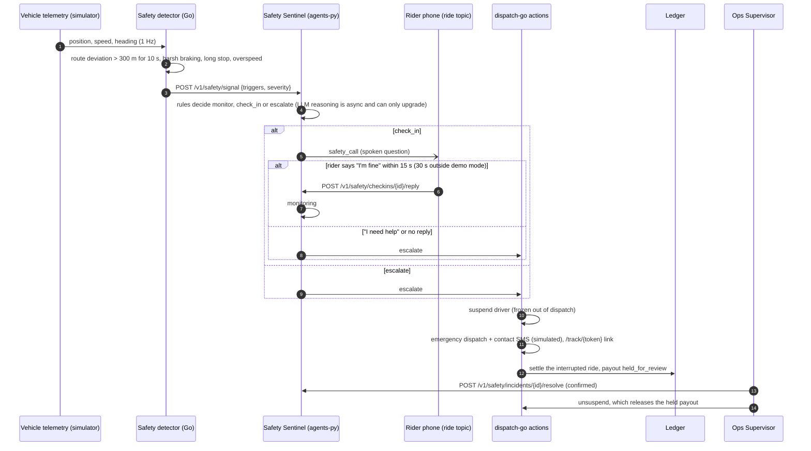
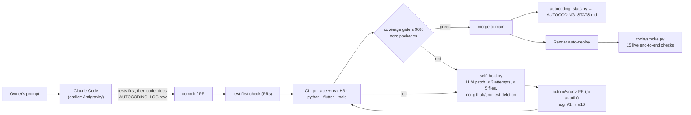

# HexaGo architecture

One Go gateway, one Python agent service, one Flutter client, Postgres with pgvector, and Redis, deployed on Render's free plan. This page shows how the pieces fit together, and states plainly what is **built**, what is **simulated**, and how each part would be upgraded for production.

Deeper dives: [DISPATCH_BROKER.md](DISPATCH_BROKER.md) · [FLEET_SIMULATOR.md](FLEET_SIMULATOR.md) · [API.md](API.md) · [AUTOCODING.md](AUTOCODING.md) · [PROJECT_CONTEXT.md](../PROJECT_CONTEXT.md)

## 1. System

All public traffic goes through one origin, `dispatch-go`. The agents service is reachable only through the gateway's proxy (it also has its own URL for health checks). Each service degrades instead of crashing: without `DATABASE_URL` it uses in-memory stores, and without `REDIS_URL` it uses in-process pub/sub and counters.

## 2. Dispatch flow

Matching is deterministic Go. No LLM is on the hot path. Live p50 is about 120 µs and p99 about 600 µs (`GET /v1/metrics/dispatch`).

## 3. Safety flow

Every step is written to `incident_timeline` and `agent_events`. The Ops Command Center shows the timeline, the transcript, and a replay of the vehicle's path against the planned route.

## 4. Ledger posting (one completed ride)

```mermaid
flowchart LR
    RC["ride completed<br/>dispatch.OnRideCompleted"] --> CS["ComputeSplit (pure)<br/>int64 paise"]
    CS --> JE["journal entry<br/>idempotency key ride:&lt;id&gt;<br/>sum of postings = 0"]

    subgraph JE_P["postings (debit +, credit −)"]
        W["rider_wallet  +wallet share"]
        PC["payment_clearing  +card share"]
        PR["promo_wallet  +promo"]
        DP["driver_payable 75% / fleet_operator_payable 80%  −"]
        CL["city_levy_payable 2%  −"]
        TX["tax_payable (GST 5% of the platform fee)  −"]
        RV["platform_revenue (remainder incl. rounding)  −"]
    end
    JE --> JE_P
    JE_P --> PO{"incident on this ride?"}
    PO -->|no| PS["payout within 300 ms<br/>driver_payable → payment_clearing<br/>payout_sent"]
    PO -->|yes| PH["payout held_for_review<br/>payout_held"]
    PH -->|Ops Supervisor unsuspend| PS
```

Invariants, each enforced in code and in the database:
- Every entry sums to zero: checked in Go and by a deferred Postgres constraint trigger.
- Entries are append-only. Refunds are reversal entries.
- Rider wallets and payables can never go negative: a CHECK constraint, plus a bounded retry when concurrent postings race.
- `GET /v1/ledger/trial-balance` reports `total_paise: 0` live. The Settlement agent re-audits entries and payouts every 60 s.
- The city levy is fixed at 2% in `ComputeSplit`. The Legal agent stores a `city_levy_pct` rule per city, but it is informational only: the ledger does not read it yet.

## 5. Autocoding pipeline

## 6. RFP to implementation

Legend: **Built**: running in production on Render. **Simulated**: real code paths, with a stand-in where an external party would be. **Upgrade path**: what production would change.

### Platform

| RFP capability | Status | What exists today | Production upgrade path |
|---|---|---|---|
| Real-time dispatch with geospatial indexing | **Built** | H3 (res 9, real C library via CGO), k-ring search, 64×64 sharded in-memory index, Redis GEO mirror, p99 under 1 ms | Partition the index by city or region across gateway replicas, with consistent hashing on H3 res-5 parents |
| Live location store at scale | **Built** (single node) | In-memory index plus Redis GEO set, positions streamed at 1 Hz | **ScyllaDB** (or Cassandra) for durable location history and trip telemetry at millions of writes per second; Redis stays the hot cache |
| Vehicles and drivers | **Simulated** | 300-vehicle simulator (tiers including AV and fleet operators, battery, ratings) with rush_hour, rain_storm, concert_exit and safety_incident scenarios | Real driver app telemetry. The Driver module is in progress in `apps/`. AV fleet operator APIs |
| API gateway | **Built** | Go/Chi gateway: CORS, API keys, scopes, per-key token-bucket rate limits in Redis, reverse proxy to agents-py | **Envoy** (or another managed L7 gateway) in front for mTLS, global rate limiting, retries and circuit breaking; the Go service keeps the domain logic |
| Real-time streaming | **Built** | WebSocket `/v1/stream` with topics (`ride:<id>`, `drivers`, `ops`), fan-out across instances via Redis pub/sub | Managed pub/sub (NATS JetStream or Kafka) for durable, replayable streams |
| Agent memory and semantic search | **Built** | pgvector (768-dim Gemini embeddings) with a keyword fallback | **Qdrant** (or a managed vector DB) when memory outgrows a single Postgres |
| Natural-language, multi-leg booking | **Built** | LangGraph planner, LLM with rule-based fallback, clarifying questions, arrive-by back-scheduling, saved places | Places and geocoding API, rider history and personalization |
| Voice | **Built** (on-device) | Text-to-speech and speech-to-text on the call screen, typed fallback, `/v1/agents/booking/voice` transcription | Telephony provider (PSTN or VoIP) for real calls |
| Dynamic surge pricing | **Built** | Per-H3-cell supply/demand multiplier, recomputed every 30 s, capped, with a surge-map API | Elasticity model trained on real demand; regulator caps per city |
| Safety monitoring | **Built** | Go detector (deviation, harsh braking, stops, overspeed), Sentinel rules, check-in, escalation, driver suspension, timeline and path replay | Audio distress model, crash detection from phone IMU |
| Emergency services and contact SMS | **Simulated** | `POST /v1/safety/emergency/dispatch` and `/notify-contact` log the payload and return `"simulated": true`; the live-tracking link is real | **Real emergency APIs** (India ERSS 112 integration, or a provider such as RapidSOS) and an SMS gateway |
| Payments and payouts | **Simulated** money, **Built** ledger | Double-entry ledger in paise, instant payouts recorded to `payment_clearing`, refunds, holds; no money moves | **Real payments**: a PSP (Razorpay, Stripe) for card and UPI collection, RazorpayX or another payouts API for drivers, webhook reconciliation into `payment_clearing` |
| Audit trail | **Built** | Append-only `agent_events` with model, tokens, latency, fallback and reason | Ship to a WORM store or data warehouse; retention policies |
| Public API and SDKs | **Built** | OpenAPI 3.1 (`/openapi.json`, `/docs`), scoped keys, HMAC-signed webhooks with retries, Python and TypeScript SDKs | Developer portal, OAuth client credentials, usage billing |
| Multi-platform clients | **Built** | Flutter: web, Windows (release zip), Android (debug-signed APK) | Signed store builds (Play Store, MSIX), iOS and macOS |
| Deployment and operations | **Built** (free tier) | Render: 3 services, Postgres, Key Value; `/healthz` and `/metrics` everywhere; keep-warm; `tools/smoke.py` | **Kubernetes** (EKS, GKE or AKS) with HPA, multi-zone, managed Postgres with replicas, Prometheus and Grafana, canary deploys |
| 100% AI-written code | **Built** | Test-first check, 96% coverage gate, self-heal PRs, autocoding log and stats | Same pipeline, with required reviews from a second AI reviewer |

### The 11 agents

| Agent | Status | What runs today | Deterministic fallback |
|---|---|---|---|
| Booking Intent | **Active** | LangGraph parse → resolve → itinerary → present; LLM via the guardrailed chain | Regex and structured rule parser (same plan shape) |
| Dispatch Broker | **Active** | Go H3 matcher with scored ranking, upgrades and re-dispatch | It *is* the deterministic algorithm; no LLM on the hot path |
| Surge Equilibrium | **Active** | Per-cell supply/demand multipliers, surge map, quotes | Fixed multiplier curve on the cell's supply/demand ratio |
| Safety Sentinel | **Active** | Rules decide; LLM reasoning is async and upgrade-only; check-in and escalation | Pure rules (always available) |
| Settlement | **Active** | Ledger split in Go; agent audits entries and payouts every 60 s; LLM explains flags | Deterministic checks (the LLM never decides) |
| Demand Forecast | **Active** | Every 60 s: Holt smoothing per H3 res-8 cell, time-of-day curve, same-hour history, scenario boosts; heatmap now / +15 / +30 min; LLM explains the top 5 hotspots asynchronously (cleared whenever the active scenarios change) | Template explanations; the numbers never come from the LLM |
| Legal & Jurisdiction | **Active** | `POST /v1/legal/ingest`: the LLM extracts a rule change set, values are bounds-checked and applied with an audit row; Pricing reads the surge cap per city | Regex extractor (its explicit numbers win over the LLM) |
| Ops Supervisor | **Active** | Heartbeat every 300 s, LLM budget and cache guardrails, confirms incident resolution and unsuspend, Autonomous Ops Report every 300 s | Circuit breaker to the rule engines |
| Pool Batching | **Planned** | Listed in the roster as PLANNED | Detour threshold below 15% added ETA (designed, not built) |
| Compliance Vision | **Planned** | Listed as PLANNED | Manual hold queue and heuristic OCR |
| Support & Dispute | **Planned** | Refund endpoint exists (`POST /v1/ledger/refunds`); no agent yet | Canned escalation workflow and credit matrix |

Active (8): Dispatch Broker, Booking Intent, Surge Equilibrium, Demand Forecast, Safety Sentinel, Settlement, Legal & Jurisdiction, Ops Supervisor. Planned (3): Pool Batching, Compliance Vision, Support & Dispute.

`GET /v1/agents` returns this roster live, with status, `decisions_last_hour`, `last_decision` and `fallback_rate`.
