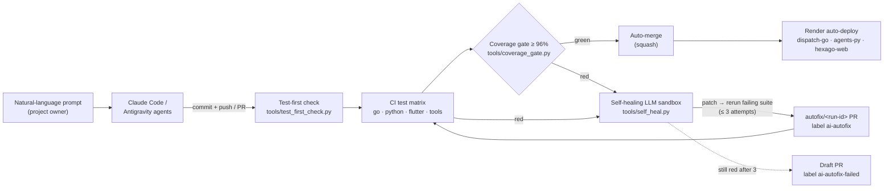

# HexaGo's zero-human code assembly line

Every line of HexaGo is written by AI agents. This page describes the pipeline that takes
a natural-language prompt to a deployed change, and the self-healing loop that repairs a red
build without a person touching the code.

Live numbers: **[AUTOCODING_STATS.md](AUTOCODING_STATS.md)** (regenerated by CI on every push
to `main`). Session-by-session history: **[AUTOCODING_LOG.md](AUTOCODING_LOG.md)**.

## 1. Prompt → agents
The owner writes a prompt; Claude Code (earlier, Google Antigravity) writes the code, the
tests first, and the docs, following [PROJECT_CONTEXT.md](../PROJECT_CONTEXT.md) and
[CLAUDE.md](../CLAUDE.md). Each session adds a row to [AUTOCODING_LOG.md](AUTOCODING_LOG.md).

## 2. Test-first check (`test-first` job, PRs only)
[`tools/test_first_check.py`](../tools/test_first_check.py) fails a PR that adds a new
source file under `services/` with no matching test:

| New file | Needs |
|---|---|
| `foo.go` | `foo_test.go` in the same directory, or any new `*_test.go` there in the same PR |
| `foo.py` | `test_foo.py` or `foo_test.py` in that service's `tests/` tree |

Skipped: generated files (`*.pb.go`, `*_gen.go`, `zz_generated*`, `*_pb2.py`, or a
`Code generated … DO NOT EDIT` header), entrypoints (`main.go`, `cmd/**`, `main.py`,
`__init__.py`, `conftest.py`) and migrations.

## 3. CI test matrix + coverage gate ([`ci.yml`](../.github/workflows/ci.yml))

| Job | What runs |
|---|---|
| `go` | `go vet`, `go test -race -coverpkg=./internal/...` with CGO (real H3) and a Redis service |
| `python` | `ruff check`, `pytest --cov` (Cobertura XML) |
| `flutter` | `flutter analyze`, `flutter test` |
| `tools` | ruff + the assembly line's own unit tests (`tools/tests`) |
| `coverage-gate` | [`tools/coverage_gate.py`](../tools/coverage_gate.py) over both reports |
| `autocoding-stats` | on `main` only: regenerates [AUTOCODING_STATS.md](AUTOCODING_STATS.md), commits it with `[skip ci]` |

The gate applies only to the **core packages** listed in
[`tools/coverage_targets.yml`](../tools/coverage_targets.yml): Go `internal/geo`,
`internal/fleet`, `internal/matching` and Python `src/agents_py/core`. Any package
below **96%** fails the build. The per-package table goes to the job summary. Go coverage
uses `-coverpkg`, so a statement counts as covered whichever package's tests run it.
To gate a new package (ledger, safety, pricing), add its directory to the YAML. A listed
package with no code yet shows as *pending* and doesn't fail the gate.

Caching: Go modules (`setup-go`), pip (`setup-python`) and the Flutter SDK + pub cache
(`flutter-action`) keep a full run to a few minutes.

## 4. Self-healing LLM sandbox ([`self-heal.yml`](../.github/workflows/self-heal.yml))
Triggered by `workflow_run` when **CI** ends in `failure` on `main` or a same-repo PR.
[`tools/self_heal.py`](../tools/self_heal.py) runs in two phases. The healer itself is always
checked out from `main` (trusted code) and operates on the failing commit, so a PR branched
from an older `main`, or one that edits `tools/`, can't change how it is healed.

1. **plan**: checks the guardrails, maps each failed job to a suite (`go`, `python`,
   `flutter`, `tools`, `coverage-gate`, `test-first`), and sets up only those toolchains.
2. **fix**:
   - downloads the failing job logs (GitHub REST API);
   - extracts failing tests (`--- FAIL`, pytest `FAILED`, Flutter `[E]`), Go package
     failures, panics and stack-trace file:line references;
   - collects the referenced source and test files, plus the rest of each failing Go package
     (capped at ~60k chars);
   - reruns the failing suite to confirm it reproduces. If it passes, the failure was flaky
     and **no LLM call is made**;
   - asks the LLM through LiteLLM (key `GEMINI_API_KEY`) for a short explanation and a
     minimal unified diff. Models are tried in order: `LLM_MODEL`, then `LLM_FALLBACK_MODELS`
     (defaults `gemini/gemini-3.5-flash`, then `gemini/gemini-3-flash-preview,gemini/gemini-3.5-flash-lite`;
     each model has its own free-tier quota). A retired model (404) or a spent daily quota is
     dropped for the run; a 429/5xx/timeout backs off (15/30/60/90 s) and moves on to the next
     model, restarting the chain after a backoff. Each call times out after
     `SELF_HEAL_LLM_TIMEOUT_S` (default 180 s, never below 90 s: gemini-3.5-flash thinks ~40 s).
     An LLM error counts as a failed attempt instead of crashing the run;
   - checks the diff against the guardrails, applies it (`git apply --recount`, falling back
     to `patch --fuzz`), and reruns **only the failing suites**;
   - loops up to **3 attempts**, each time sending back the previous patch and its new
     failure output (each attempt starts from the original commit).
3. **publish** on branch `autofix/<run-id>`, PR into the branch that failed:
   - **green:** label `ai-autofix`, body with the explanation, the attempts log and the
     before/after test output. CI is dispatched on the branch and auto-merge (squash) is
     enabled. If the base branch has no required checks, GitHub won't queue auto-merge;
     the healer then waits for that CI run and squash-merges if it's green.
   - **still red:** a **draft** PR labelled `ai-autofix-failed`, with the last patch that
     applied and the full attempts log, left for review.

### Guardrails
| Rule | Enforced by |
|---|---|
| Never touch `.github/` | patch validator rejects the patch |
| Never delete tests, remove a test function, or add a skip | patch validator (Go `func Test*`, pytest `def test_*`, Dart `test(`/`testWidgets(`/`group(`) |
| Reject patches that only edit existing tests (fix the code under test instead) | patch validator (every touched file is an existing test file) |
| At most 5 files per patch | patch validator |
| No loops: skip `autofix/*` branches and autofix merge commits (`[ai-autofix` in the title) | workflow `if:` + `trigger_skip_reason` |
| One healing run per failing workflow run (≤ 3 LLM calls) | concurrency group per run id, `run_attempt == 1`, and a skip if `autofix/<run-id>` already exists |
| No secrets for fork code | runs only when the head repository is this repository |

The guardrails, log parsing and diff application have unit tests in
[`tools/tests/test_self_heal.py`](../tools/tests/test_self_heal.py), which mock the LLM and
the GitHub API and use real temporary git repositories.

## 5. Merge → Render auto-deploy
Render watches `main` and redeploys `dispatch-go`, `agents-py` and `hexago-web` on every
merge (see the live URLs in [PROJECT_CONTEXT.md](../PROJECT_CONTEXT.md)).

## Repository settings this needs
| Setting | Where | Why |
|---|---|---|
| `GEMINI_API_KEY` secret | Settings → Secrets and variables → Actions | LLM calls |
| `LLM_MODEL` / `LLM_FALLBACK_MODELS` variables (optional) | Settings → Secrets and variables → Actions → Variables | Primary model and comma-separated fallbacks |
| Workflow permissions: **Read and write** + **Allow GitHub Actions to create and approve pull requests** | Settings → Actions → General | Push `autofix/*`, open PRs |
| **Allow auto-merge** | Settings → General → Pull Requests | Native auto-merge on autofix PRs |
| `AUTOFIX_TOKEN` secret (optional, fine-grained PAT) | Secrets | Pushes from `GITHUB_TOKEN` don't trigger workflows. With a PAT, autofix PRs get normal `pull_request` CI |

## Evidence
The deliberate-bug demo (an off-by-one in the hex k-ring walk in
`services/dispatch-go/internal/geo/hexgrid.go`) is recorded in
[AUTOCODING_LOG.md](AUTOCODING_LOG.md) with links to the bug PR, the failing CI run, the
self-heal run, and the `ai-autofix` PR.
